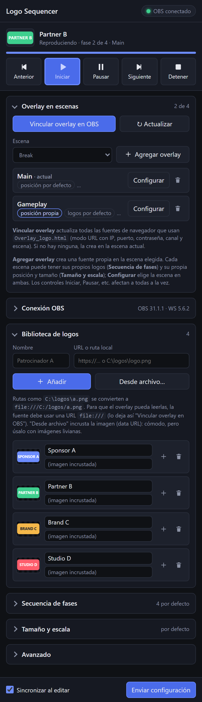
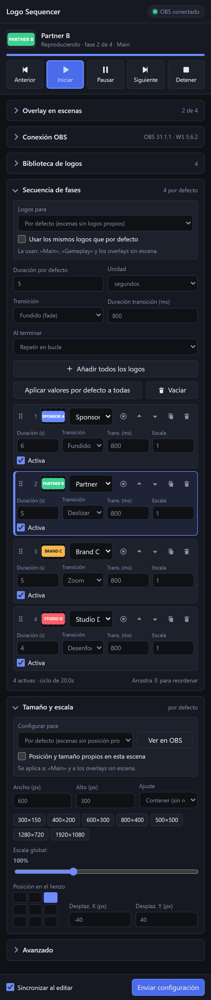

# Logo Sequencer para OBS Studio

[English](README.md) · **Español**

Muestra los logos de tus patrocinadores, auspiciadores o marcas en OBS como una secuencia automática, con transiciones suaves y controlada desde un dock dentro de OBS.

[](https://github.com/KaguroDev/logo-sequencer-plugin/releases/latest)


<table>
  <tr>
    <td align="center"></td>
    <td align="center"></td>
  </tr>
  <tr>
    <td align="center"><sub>Reproducción, escenas y biblioteca de logos</sub></td>
    <td align="center"><sub>Secuencia de fases, tamaño y posición</sub></td>
  </tr>
</table>

---

## Características

- **Dock de control** dentro de OBS: biblioteca de logos, secuencia de fases, tamaño y posición. Todo se guarda entre sesiones.
- **Transiciones**: fundido, deslizar (←, →, ↑), zoom, desenfoque o corte, con duración configurable por logo.
- **Configuración por escena**: cada escena puede mostrar sus propios logos con su propia posición y tamaño (por ejemplo, arriba a la derecha en una y abajo a la izquierda en otra).
- **Atajos de teclado** en *Ajustes → Atajos*: Iniciar, Pausar, Iniciar/Pausar, Siguiente, Anterior, Detener.
- **Sin configuración manual**: el plugin lee solo el puerto y la contraseña del WebSocket de OBS y crea la fuente del overlay por ti.
- **Español e inglés**: el idioma se elige en el instalador.

## Requisitos

- Windows 10/11 de 64 bits
- OBS Studio **31 o superior**
- Servidor WebSocket de OBS activado: *Herramientas → Ajustes del servidor WebSocket → Activar servidor WebSocket*
- Conexión a internet: el dock y el overlay cargan la librería `obs-websocket-js` desde un CDN

## Instalación

1. Descarga `logo-sequencer-<versión>-windows-x64-setup.exe` desde la [última versión](https://github.com/KaguroDev/logo-sequencer-plugin/releases/latest).
2. **Cierra OBS** y ejecuta el instalador. Pide permisos de administrador.
3. Elige **Español** o **English**. Define el idioma del instalador y del plugin.

> **Windows SmartScreen** puede mostrar un aviso porque el instalador no está firmado:
> pulsa *Más información → Ejecutar de todas formas*.

El plugin se instala para todos los usuarios en `C:\ProgramData\obs-studio\plugins\logo-sequencer\`.

## Primeros pasos

1. Abre OBS y activa el servidor WebSocket (ver *Requisitos*).
2. Menú **Docks** → marca **Logo Sequencer**.
3. En el dock, sección **Overlay en escenas**: elige una escena y pulsa **Agregar overlay**.
   Repite en cada escena donde quieras los logos.
4. En **Biblioteca de logos**, añade tus logos por URL, ruta local (`C:\logos\patrocinador.png`) o arrastrando imágenes a la lista.
5. Pulsa **Añadir todos los logos** en **Secuencia de fases**, ajusta las duraciones y pulsa **▶ Iniciar**.

También puedes usar **Herramientas → Logo Sequencer: crear / actualizar overlay** para crear el overlay en la escena actual.

### Logos distintos en cada escena

En **Secuencia de fases**, el selector **Logos para** elige qué secuencia se edita:

- **Por defecto**: la usan todas las escenas que tienen marcado *Usar los mismos logos que por defecto* (es lo inicial).
- **Una escena**: desmarca *Usar los mismos logos que por defecto* y esa escena pasa a tener su propia secuencia, que empieza como copia de la por defecto. Vuelve a marcar la casilla para usar otra vez la por defecto.

### Posición distinta en cada escena

En **Tamaño y escala**, el selector **Configurar para** funciona igual: al cambiar cualquier valor de una escena, esa escena pasa a tener su **posición propia**. **Ver en OBS** cambia a esa escena para ver el resultado.

El botón **Configurar** de cada escena en *Overlay en escenas* elige esa escena en las dos secciones a la vez.

### Controles y atajos

Iniciar, Pausar, Siguiente, Anterior y Detener actúan sobre todas las escenas a la vez.

| Acción | Botón del dock | Tecla en el dock | Atajo de OBS |
|---|---|---|---|
| Iniciar / Pausar | ▶ / ⏸ | `Espacio` | *Logo Sequencer: Iniciar / Pausar* |
| Siguiente logo | ⏭ | `→` | *Logo Sequencer: Siguiente logo* |
| Logo anterior | ⏮ | `←` | *Logo Sequencer: Logo anterior* |
| Detener | ⏹ | `Esc` | *Logo Sequencer: Detener* |

Los atajos de OBS se asignan en *Ajustes → Atajos* (busca "Logo Sequencer") y funcionan aunque el dock esté oculto.

## Cambiar el idioma

Vuelve a ejecutar el instalador y elige el otro idioma. Tus logos y ajustes se conservan.

## Si algo falla

| Problema | Solución |
|---|---|
| El dock dice *Sin conexión* o *Contraseña incorrecta* | Activa el servidor WebSocket y reinicia OBS. Si cambias la contraseña del WebSocket, reinicia OBS para que el plugin la vuelva a leer. |
| El overlay no responde | Pulsa **Vincular overlay en OBS** en el dock. |
| Renombraste una escena | Pulsa **Vincular overlay en OBS**: la fuente se asocia al nuevo nombre y conserva sus logos y su posición. |
| No se ve una imagen local | Usa una ruta como `C:\logos\a.png`; la fuente debe estar en modo URL (lo deja así **Vincular overlay en OBS**). |
| El dock muestra un aviso sobre obs-browser | Falta el plugin de navegador de OBS. Viene incluido en la instalación normal de OBS para Windows. |
| Cualquier otro problema | *Ayuda → Archivos de registro → Ver el registro actual* y busca `logo-sequencer`. |

Si usabas la versión de archivos sueltos (dock de navegador personalizado + script Lua), quita el dock y el script antiguos para no tener controles duplicados. La fuente de overlay antigua se reutiliza: **Vincular overlay en OBS** le cambia la URL.

## Desinstalar

*Configuración → Aplicaciones → Aplicaciones instaladas → Logo Sequencer (plugin de OBS) → Desinstalar*.
Después borra de tus escenas las fuentes *Overlay Logos* que hayas agregado (clic derecho → Eliminar).

---

## Compilar desde el código fuente

Necesitas:

- **Visual Studio 2026** (o 2022) con la carga de trabajo **Desarrollo para el escritorio con C++** y el SDK de Windows 10.0.22621 o posterior
- **CMake 3.28+** y **Git** en el `PATH`
- **NSIS 3** para generar el instalador (`winget install NSIS.NSIS`). Instálalo **antes** del primer `cmake --preset`.

```powershell
cmake --preset windows-x64-vs2026          # Visual Studio 2022: windows-x64
cmake --build --preset windows-x64-vs2026 --target installer
```

O todo en un paso:

```powershell
powershell -ExecutionPolicy Bypass -File installer\build-installer.ps1
```

La primera configuración descarga el código de OBS y sus dependencias (Qt6 incluido). Tarda varios minutos y solo ocurre la primera vez. El instalador queda en `release\`.

Desde Visual Studio: abre `build_x64\logo-sequencer.slnx`, elige **RelWithDebInfo** y compila el proyecto **installer** (carpeta *Packaging*). Si **installer** no aparece, CMake no encontró NSIS: instálalo y vuelve a ejecutar `cmake --preset`.

La versión se define en `buildspec.json`; después de cambiarla, vuelve a ejecutar `cmake --preset`.
Si mueves la carpeta del proyecto, borra `build_x64` y `.deps\obs-studio-*\build_x86` antes de volver a configurar (guardan rutas absolutas).

Sin instalador: cierra OBS y, en una consola **como administrador**, ejecuta `cmake --install build_x64 --config RelWithDebInfo`.

### Estructura del proyecto

| Archivo | Contenido |
|---|---|
| `src/plugin-main.cpp` | Código del plugin: dock, menú Herramientas, atajos, idioma |
| `data/Control_logo.html` | Dock de control (HTML/JS) |
| `data/Overlay_logo.html` | Overlay que muestra la fuente de navegador |
| `data/locale/*.ini` | Textos del plugin (`en-US`, `es-ES`) |
| `installer/logo-sequencer.nsi` | Script del instalador NSIS (español/inglés) |
| `installer/build-installer.ps1` | Compila el plugin y el instalador en un paso |
| `buildspec.json` | Nombre, versión y versión de OBS contra la que se compila |
| `docs/images/` | Capturas usadas en este documento |

### Traducciones

- Textos del plugin (menús, atajos, mensajes): `data/locale/en-US.ini` y `es-ES.ini`.
- Dock y overlay: el código está escrito en español; los textos van dentro de `tr('…')` y su traducción al inglés está en el objeto `EN` al principio del `<script>` de cada HTML.
- Instalador: bloques `LangString` en `installer/logo-sequencer.nsi`.

### Versión de OBS

`buildspec.json` compila contra OBS 31.1.1; el plugin carga también en OBS 32. Para compilar contra otra versión, cambia la versión y sus hashes en `buildspec.json` (ver la plantilla original).

Basado en la plantilla oficial [obs-plugintemplate](https://github.com/obsproject/obs-plugintemplate).

## Licencia

[GPL-2.0](LICENSE) © 2026 [KaguroDev](https://github.com/KaguroDev)
