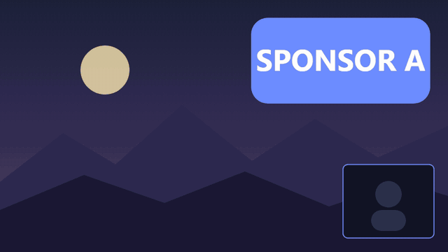
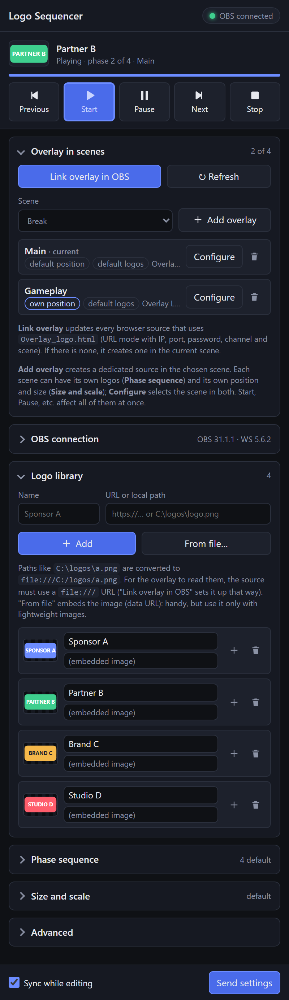
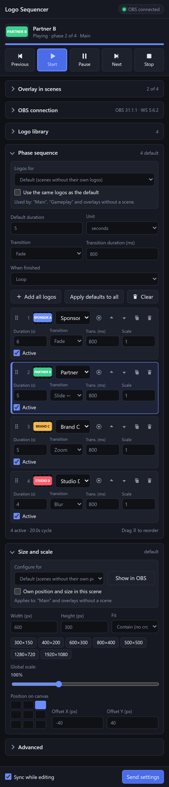
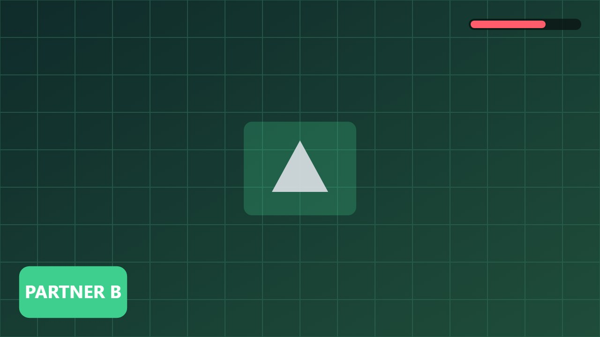

# Logo Sequencer for OBS Studio

**English** · [Español](LEEME.md)

Show your sponsor, partner or brand logos in OBS as an automatic sequence, with smooth transitions, controlled from a dock inside OBS.

[](https://github.com/KaguroDev/logo-sequencer-plugin/releases/latest)


<p align="center">
  
  <br><sub>Fade, slide, zoom and blur transitions between logos</sub>
</p>

<table>
  <tr>
    <td align="center"></td>
    <td align="center"></td>
  </tr>
  <tr>
    <td align="center"><sub>Playback, scenes and logo library</sub></td>
    <td align="center"><sub>Phase sequence, size and position</sub></td>
  </tr>
</table>

**What your viewers see** — the overlay on top of your scenes, with its own logos and position in each one:

<table>
  <tr>
    <td align="center"></td>
    <td align="center"></td>
  </tr>
  <tr>
    <td align="center"><sub>“Main” scene: default sequence, top-right</sub></td>
    <td align="center"><sub>“Gameplay” scene: its own logos, smaller, bottom-left</sub></td>
  </tr>
</table>

<sub>Screenshots with sample logos and illustrative backgrounds.</sub>

---

## Features

- **Control dock** inside OBS: logo library, phase sequence, size and position. Everything is saved between sessions.
- **Transitions**: fade, slide (←, →, ↑), zoom, blur or cut, with configurable duration per logo.
- **Per-scene setup**: each scene can show its own logos in its own position and size (for example, top-right in one scene and bottom-left in another).
- **Hotkeys** in *Settings → Hotkeys*: Start, Pause, Start/Pause, Next, Previous, Stop.
- **Zero configuration**: the plugin reads the OBS WebSocket port and password by itself and creates the overlay source for you.
- **English and Spanish**: you choose the language in the installer.

## Requirements

- Windows 10/11, 64-bit
- OBS Studio **31 or later**
- OBS WebSocket server enabled: *Tools → WebSocket Server Settings → Enable WebSocket server*
- Internet connection: the dock and the overlay load the `obs-websocket-js` library from a CDN

## Installation

1. Download `logo-sequencer-<version>-windows-x64-setup.exe` from the [latest release](https://github.com/KaguroDev/logo-sequencer-plugin/releases/latest).
2. **Close OBS** and run the installer. It asks for administrator permissions.
3. Choose **English** or **Español**. This sets the language of the installer and of the plugin.

> **Windows SmartScreen** may warn you because the installer is not code-signed:
> click *More info → Run anyway*.

The plugin is installed for all users in `C:\ProgramData\obs-studio\plugins\logo-sequencer\`.

## Getting started

1. Open OBS and enable the WebSocket server (see *Requirements*).
2. **Docks** menu → check **Logo Sequencer**.
3. In the dock, **Overlay in scenes** section: choose a scene and press **Add overlay**.
   Repeat for every scene where you want the logos.
4. In **Logo library**, add your logos by URL, local path (`C:\logos\sponsor.png`) or by dragging images onto the list.
5. Press **Add all logos** in **Phase sequence**, adjust the durations and press **▶ Start**.

You can also use **Tools → Logo Sequencer: create / update overlay** to create the overlay in the current scene.

### Different logos per scene

In **Phase sequence**, the **Logos for** selector chooses which sequence you are editing:

- **Default**: used by every scene that has *Use the same logos as the default* checked (the initial setting).
- **A scene**: uncheck *Use the same logos as the default* and that scene gets its own sequence, starting as a copy of the default one. Check the box again to go back to the default sequence.

### Different position per scene

In **Size and scale**, the **Configure for** selector works the same way: when you change any value for a scene, that scene gets its **own position**. **Show in OBS** switches to that scene so you can see the result.

The **Configure** button next to each scene in *Overlay in scenes* selects that scene in both sections at once.

### Controls and hotkeys

Start, Pause, Next, Previous and Stop act on every scene at the same time.

| Action | Dock button | Dock key | OBS hotkey |
|---|---|---|---|
| Start / Pause | ▶ / ⏸ | `Space` | *Logo Sequencer: Start / Pause* |
| Next logo | ⏭ | `→` | *Logo Sequencer: Next logo* |
| Previous logo | ⏮ | `←` | *Logo Sequencer: Previous logo* |
| Stop | ⏹ | `Esc` | *Logo Sequencer: Stop* |

OBS hotkeys are assigned in *Settings → Hotkeys* (search for "Logo Sequencer") and work even when the dock is hidden.

## Changing the language

Run the installer again and choose the other language. Your logos and settings are kept.

## Troubleshooting

| Problem | Solution |
|---|---|
| The dock says *Disconnected* or *Wrong password* | Enable the WebSocket server and restart OBS. If you change the WebSocket password, restart OBS so the plugin reads it again. |
| The overlay does not respond | Press **Link overlay in OBS** in the dock. |
| You renamed a scene | Press **Link overlay in OBS**: the source is linked to the new name and keeps its logos and position. |
| A local image is not shown | Use a path like `C:\logos\a.png`; the source must be in URL mode (**Link overlay in OBS** sets it up). |
| The dock shows a warning about obs-browser | The OBS browser plugin is missing. It is included in the normal OBS installation for Windows. |
| Anything else | *Help → Log Files → View Current Log* and search for `logo-sequencer`. |

## Uninstall

*Settings → Apps → Installed apps → Logo Sequencer (OBS plugin) → Uninstall*.
Then delete any *Overlay Logos* sources you added to your scenes (right-click → Remove).

---

## Building from source

Requirements:

- **Visual Studio 2026** (or 2022) with the **Desktop development with C++** workload and Windows SDK 10.0.22621 or later
- **CMake 3.28+** and **Git** in the `PATH`
- **NSIS 3** to build the installer (`winget install NSIS.NSIS`). Install it **before** the first `cmake --preset`.

```powershell
cmake --preset windows-x64-vs2026          # Visual Studio 2022: windows-x64
cmake --build --preset windows-x64-vs2026 --target installer
```

Or in a single step:

```powershell
powershell -ExecutionPolicy Bypass -File installer\build-installer.ps1
```

The first configuration downloads the OBS sources and dependencies (including Qt6). It takes several minutes and only happens once. The installer is written to `release\`.

From Visual Studio: open `build_x64\logo-sequencer.slnx`, choose **RelWithDebInfo** and build the **installer** project (in the *Packaging* folder).

The version is set in `buildspec.json`. Run `cmake --preset` again after changing it.

### Project structure

| File | Contents |
|---|---|
| `src/plugin-main.cpp` | Plugin code: dock, Tools menu, hotkeys, language |
| `data/Control_logo.html` | Control dock (HTML/JS) |
| `data/Overlay_logo.html` | Overlay shown in the browser source |
| `data/locale/*.ini` | Plugin texts (`en-US`, `es-ES`) |
| `installer/logo-sequencer.nsi` | NSIS installer script (English/Spanish) |
| `installer/build-installer.ps1` | Builds the plugin and the installer in one step |
| `buildspec.json` | Name, version and OBS version to build against |
| `docs/images/` | Screenshots used in this README |

Based on the official [obs-plugintemplate](https://github.com/obsproject/obs-plugintemplate).

## License

[GPL-2.0](LICENSE) © 2026 [KaguroDev](https://github.com/KaguroDev)
