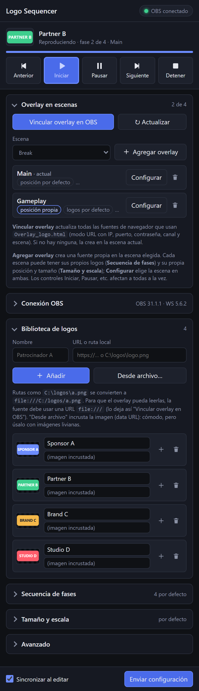
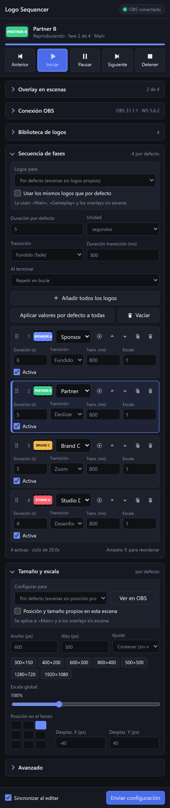
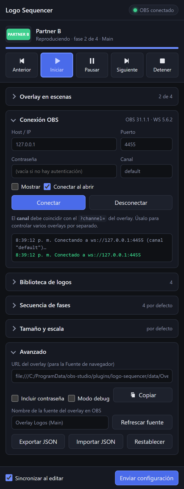

# Logo Sequencer — Guía de uso

[English](GUIDE.md) · **Español** · [← Volver al LEEME](../LEEME.md)

Esta guía explica cada parte del dock de Logo Sequencer, desde la primera configuración hasta los ajustes por escena.

## Contenido

1. [Antes de empezar](#1-antes-de-empezar)
2. [El dock de un vistazo](#2-el-dock-de-un-vistazo)
3. [Paso 1 — Agrega el overlay a tus escenas](#3-paso-1--agrega-el-overlay-a-tus-escenas)
4. [Paso 2 — Arma tu biblioteca de logos](#4-paso-2--arma-tu-biblioteca-de-logos)
5. [Paso 3 — Crea la secuencia](#5-paso-3--crea-la-secuencia)
6. [Paso 4 — Tamaño y posición](#6-paso-4--tamaño-y-posición)
7. [Logos y posición distintos en cada escena](#7-logos-y-posición-distintos-en-cada-escena)
8. [Reproducir la secuencia](#8-reproducir-la-secuencia)
9. [Conexión, opciones avanzadas y copias de seguridad](#9-conexión-opciones-avanzadas-y-copias-de-seguridad)
10. [Consejos y preguntas frecuentes](#10-consejos-y-preguntas-frecuentes)

---

## 1. Antes de empezar

1. **Instala el plugin** con el instalador de la [última versión](https://github.com/KaguroDev/logo-sequencer-plugin/releases/latest) (cierra OBS antes).
2. **Activa el servidor WebSocket de OBS**: *Herramientas → Ajustes del servidor WebSocket → Activar servidor WebSocket*. Después reinicia OBS.
   El dock y el overlay se comunican a través de este servidor. No hace falta copiar el puerto ni la contraseña: el plugin los lee solo.
3. **Abre el dock**: menú *Docks* → marca **Logo Sequencer**. Puedes arrastrarlo junto a tus otros docks.

> El dock y el overlay necesitan conexión a internet para cargar la librería `obs-websocket-js`.

## 2. El dock de un vistazo

De arriba abajo:

| Parte | Qué hace |
|---|---|
| **Indicador de conexión** (arriba a la derecha) | *OBS conectado* (verde), *Conectando…*, *Reconectando…*, *Error* o *Sin conexión*. |
| **Reproduciendo ahora** | Miniatura, nombre del logo, estado (*Reproduciendo*, *En pausa*, *Detenido*, *Finalizado*), número de fase y escena. |
| **Barra de progreso** | Tiempo que le queda al logo actual. |
| **Controles** | ⏮ Anterior · ▶ Iniciar · ⏸ Pausar · ⏭ Siguiente · ⏹ Detener. |
| **Secciones** | *Overlay en escenas*, *Conexión OBS*, *Biblioteca de logos*, *Secuencia de fases*, *Tamaño y escala*, *Avanzado*. Haz clic en el título para abrirlas o cerrarlas. |
| **Pie** | *Sincronizar al editar* y *Enviar configuración*. |

El estado que se ve arriba es el del overlay que está **en vivo (programa)**. Si ninguno lo está, muestra el último overlay que respondió.

 

## 3. Paso 1 — Agrega el overlay a tus escenas

El **overlay** es una Fuente de navegador que muestra los logos en tu transmisión. Cada escena donde quieras logos necesita uno.

En la sección **Overlay en escenas**:

1. Elige una escena en **Escena** y pulsa **Agregar overlay**.
   Se crea en esa escena una fuente llamada `Overlay Logos (<escena>)`, del tamaño de tu lienzo.
2. Repite en cada escena donde quieras los logos.

La lista de abajo muestra las escenas que tienen el overlay:

| Elemento | Significado |
|---|---|
| *· actual* | La escena que está en programa (o en la vista previa, en Modo Estudio). |
| *posición por defecto* / *posición propia* | Si la escena usa el tamaño y la posición por defecto o los suyos ([sección 7](#7-logos-y-posición-distintos-en-cada-escena)). |
| *logos por defecto* / *logos propios* | Si la escena muestra la secuencia por defecto o la suya. |
| **Configurar** | Elige esa escena para editarla en *Secuencia de fases* y en *Tamaño y escala*. |
| 🗑 | Quita el overlay de esa escena. |

**Otros botones:**

- **Vincular overlay en OBS** — actualiza todas las fuentes del overlay (conexión, canal y escena en su URL). Si no hay ninguna, la crea en la escena actual. Úsalo si un overlay deja de responder o después de renombrar una escena: la fuente conserva sus logos y su posición con el nombre nuevo.
- **↻ Actualizar** — vuelve a leer la lista de escenas de OBS (por ejemplo, después de crear una escena).

> **Alternativa:** *Herramientas → Logo Sequencer: crear / actualizar overlay* hace lo mismo que *Vincular overlay*: actualiza todas las fuentes del overlay y, si la escena actual no tiene una, la crea ahí.
> Al iniciar OBS, el plugin también actualiza todas las fuentes del overlay automáticamente, así que un cambio de puerto o contraseña del WebSocket se aplica después de reiniciar.

## 4. Paso 2 — Arma tu biblioteca de logos

La **Biblioteca de logos** guarda todos los logos que puedes usar. Añádelos de cualquiera de estas formas:

| Forma | Cómo |
|---|---|
| **URL** | Escribe un nombre (opcional) y una dirección `https://…`, y pulsa **Añadir** (o Enter). |
| **Ruta local** | Escribe o pega una ruta como `C:\logos\patrocinador.png`. Se convierte en `file:///C:/logos/patrocinador.png`. |
| **Desde archivo…** | Elige una o varias imágenes. Quedan incrustadas en la configuración. |
| **Arrastrar y soltar** | Arrastra imágenes desde el Explorador de Windows a la lista. También quedan incrustadas. |

Si dejas el nombre vacío, se usa el nombre del archivo.

**Cada logo de la lista** muestra su miniatura, un nombre editable y su ruta o URL. Un **!** rojo en la miniatura indica que la imagen no se pudo cargar.

- **+** añade el logo a la secuencia que estás editando.
- 🗑 elimina el logo. Si se usa en alguna secuencia, el dock pregunta antes y lo quita de **todas** las secuencias.

> **Consejo:** para imágenes grandes es mejor usar **rutas locales**. Las imágenes incrustadas (*Desde archivo*, arrastrar y soltar) son cómodas, pero hacen más pesada la configuración; el dock avisa si una imagen supera 1,5 MB.
> Las imágenes PNG con fondo transparente se ven mejor en la transmisión.

## 5. Paso 3 — Crea la secuencia

Una **secuencia** es la lista ordenada de logos (*fases*) que reproduce el overlay.

**Valores por defecto** (se usan en las fases nuevas):

| Campo | Descripción |
|---|---|
| **Duración por defecto** + **Unidad** | Cuánto tiempo se ve cada logo, en *segundos* o *milisegundos* (mínimo 0,25 s). |
| **Transición** | Cómo entra un logo (ver la tabla de abajo). |
| **Duración transición (ms)** | Duración de la transición. |
| **Al terminar** | *Repetir en bucle* (empieza de nuevo), *Mantener último logo* (lo deja en pantalla) u *Ocultar* (se desvanece y se detiene). |

**Botones:**

- **Añadir todos los logos** — añade a la secuencia todos los logos de la biblioteca.
- **Aplicar valores por defecto a todas** — aplica la duración y la transición por defecto a todas las fases.
- **Vaciar** — elimina todas las fases de esta secuencia (pregunta antes).

**Cada fase** tiene:

| Control | Descripción |
|---|---|
| ⠿ | Arrastra para reordenar (o usa ▲ ▼). |
| Número y miniatura | Posición en la secuencia y el logo. |
| Selector de logo | Cambia el logo que muestra esta fase. |
| ◎ **Mostrar ahora** | Salta directamente a esta fase en el overlay. |
| ▲ ▼ | Subir / bajar. |
| ⧉ **Duplicar** | Copia la fase justo debajo. |
| 🗑 | Elimina la fase. |
| **Duración** | Tiempo en pantalla solo de esta fase. |
| **Transición** / **Trans. (ms)** | Transición de entrada y su duración para esta fase. |
| **Escala** | Tamaño de este logo respecto a los demás (1 = normal, 0,5 = la mitad, 2 = el doble). |
| **Activa** | Desmárcala para saltar la fase sin borrarla. |

La fase resaltada es la que está en pantalla. La línea bajo la lista indica cuántas fases están activas y cuánto dura un ciclo completo.

**Transiciones:**

| Transición | Efecto |
|---|---|
| Fundido | El logo nuevo aparece mientras el anterior se desvanece. |
| Deslizar ← / Deslizar → / Deslizar ↑ | El logo nuevo entra deslizándose y empuja al anterior. |
| Zoom | El logo nuevo entra creciendo; el anterior se agranda y se desvanece. |
| Desenfoque | El logo nuevo entra pasando de borroso a nítido. |
| Corte | Cambio instantáneo, sin animación. |

 

## 6. Paso 4 — Tamaño y posición

En **Tamaño y escala** defines el área donde se dibujan los logos, dentro del overlay (que tiene el tamaño de tu lienzo, por ejemplo 1920×1080).

| Campo | Descripción |
|---|---|
| **Ancho / Alto (px)** | Tamaño del área de los logos, en píxeles del lienzo. Los botones de abajo son tamaños rápidos (de 300×150 a 1920×1080). |
| **Ajuste** | *Contener* (el logo se ve entero, sin recorte), *Cubrir* (llena el área, puede recortar) o *Estirar* (llena el área, puede deformar). |
| **Escala global** | Agranda o reduce todos los logos (del 10 % al 300 %). Se multiplica por la *Escala* de cada fase. |
| **Posición en el lienzo** | Cuadrícula de nueve puntos: esquinas, bordes o centro de la pantalla. |
| **Desplaz. X / Y (px)** | Ajuste fino desde esa posición. Usa valores negativos para mover a la izquierda o hacia arriba (por ejemplo, X −40 e Y 40 en la esquina superior derecha deja un margen de 40 px). |

Los cambios se ven en el overlay al instante (ver [Sincronizar al editar](#sincronizar-al-editar)).

## 7. Logos y posición distintos en cada escena

Cada escena con overlay puede tener **sus propios logos** y **su propio tamaño y posición**. Las escenas sin ajustes propios usan los **por defecto**.

**Logos por escena** — en *Secuencia de fases*, **Logos para** elige qué editas:

- **Por defecto** — la secuencia que usan todas las escenas sin logos propios.
- **Una escena** — mientras *Usar los mismos logos que por defecto* esté marcado, la escena muestra la secuencia por defecto (aquí, solo lectura). **Desmárcalo** y la escena pasa a tener su propia secuencia, que empieza como copia de la por defecto. Vuelve a marcarlo para descartarla.

**Posición por escena** — en *Tamaño y escala*, **Configurar para** funciona igual:

- **Por defecto** — lo usan todas las escenas sin posición propia.
- **Una escena** — en cuanto cambias cualquier valor, la escena pasa a tener su **posición propia**. Desmarca *Posición y tamaño propios en esta escena* para volver a la por defecto.
- **Ver en OBS** cambia a esa escena para ver el resultado. En Modo Estudio cambia la vista previa; si no, pregunta antes, porque cambia la escena en vivo.

> **Atajo:** el botón **Configurar** de cada escena en *Overlay en escenas* elige esa escena en las dos secciones a la vez.

**Ejemplo:** la secuencia por defecto muestra cuatro patrocinadores en la esquina superior derecha. La escena *Gameplay* tiene sus propios logos (solo el patrocinador principal), más pequeños y en la esquina inferior izquierda para no tapar el HUD del juego.

## 8. Reproducir la secuencia

| Acción | Botón del dock | Tecla en el dock | Atajo de OBS |
|---|---|---|---|
| Iniciar / Pausar | ▶ / ⏸ | `Espacio` | *Logo Sequencer: Iniciar / Pausar* |
| Iniciar | ▶ | | *Logo Sequencer: Iniciar secuencia* |
| Pausar | ⏸ | | *Logo Sequencer: Pausar* |
| Siguiente logo | ⏭ | `→` | *Logo Sequencer: Siguiente logo* |
| Logo anterior | ⏮ | `←` | *Logo Sequencer: Logo anterior* |
| Detener | ⏹ | `Esc` | *Logo Sequencer: Detener* |

- Los controles actúan sobre **todas las escenas a la vez**.
- **Pausar** deja el logo en pantalla y recuerda el tiempo que le quedaba; **Iniciar** continúa desde ahí.
- **Detener** oculta el logo con su transición y vuelve al principio.
- Las teclas del dock funcionan cuando el dock tiene el foco y no estás escribiendo en un campo.
- Los **atajos de OBS** se asignan en *Ajustes → Atajos* (busca "Logo Sequencer"). Funcionan aunque el dock esté oculto: ideales para un Stream Deck.
- Si una imagen no se puede cargar, el overlay salta al siguiente logo y el dock muestra un aviso.

### Sincronizar al editar

Con **Sincronizar al editar** marcado (lo normal), cada cambio en el dock se envía al overlay automáticamente. Desmárcalo para preparar cambios sin afectar la transmisión, y pulsa **Enviar configuración** para aplicarlos todos de una vez.

## 9. Conexión, opciones avanzadas y copias de seguridad

### Conexión OBS

El plugin la rellena automáticamente. Solo la necesitas para controlar **otro OBS** de tu red o para resolver problemas.

| Campo | Descripción |
|---|---|
| **Host / IP** | `127.0.0.1` para el mismo PC. Para otro PC, su IP local (y permite el puerto en su firewall). |
| **Puerto** / **Contraseña** | En *Herramientas → Ajustes del servidor WebSocket → Mostrar información de conexión*. |
| **Canal** | Permite tener varios grupos de overlays independientes: cada dock solo controla los overlays con el mismo `?channel=`. Deja `default` si no lo necesitas. |
| **Conectar al abrir** | Conecta automáticamente al abrirse el dock. |

El registro bajo los botones muestra los eventos y errores de conexión.

### Avanzado

| Opción | Descripción |
|---|---|
| **URL del overlay** | Dirección para crear un overlay a mano (Fuente de navegador → URL, sin *Archivo local*). **Copiar** la copia. |
| **Incluir contraseña** | Añade la contraseña del WebSocket a esa URL. Las fuentes creadas con *Agregar overlay* o *Vincular overlay* siempre la incluyen. |
| **Modo debug** | Los overlays que se creen o vinculen después muestran un recuadro de estado y el contorno del área de los logos. Desactívalo y pulsa *Vincular overlay en OBS* para quitarlo. |
| **Nombre de la fuente** + **Refrescar fuente** | Recarga esa Fuente de navegador (como su botón *Actualizar la caché de la página actual*). El nombre se rellena al agregar o vincular un overlay. |
| **Exportar JSON** | Guarda logos, secuencias y ajustes en un archivo `.json`. La contraseña nunca se exporta. |
| **Importar JSON** | Carga una configuración exportada antes. Se conserva tu contraseña actual. |
| **Restablecer** | Borra logos, fases y ajustes (pregunta antes). La conexión se mantiene. |

 

### Dónde se guardan tus ajustes

Todo se guarda automáticamente dentro de OBS y se conserva al reiniciar OBS o al actualizar el plugin. Usa **Exportar JSON** como copia de seguridad o para llevar tu configuración a otro PC.

## 10. Consejos y preguntas frecuentes

**¿Puedo usar logos distintos en cada escena?** Sí, ver la [sección 7](#7-logos-y-posición-distintos-en-cada-escena).

**¿Puedo controlarlo desde un Stream Deck?** Sí: asigna los atajos de OBS (*Ajustes → Atajos*) y actívalos desde el Stream Deck.

**¿Cómo cambio el idioma?** Vuelve a ejecutar el instalador y elige el otro idioma. Tus logos y ajustes se conservan.

**El overlay no responde.** Revisa el indicador de conexión y pulsa **Vincular overlay en OBS**. Si cambiaste la contraseña del WebSocket, reinicia OBS.

**No se ve un logo.** Comprueba que la ruta o la URL sigan existiendo. Las rutas locales deben apuntar a una imagen del PC donde corre OBS.

**Renombré una escena y el overlay perdió sus ajustes.** Pulsa **Vincular overlay en OBS**: asocia la fuente al nombre nuevo y conserva sus logos y su posición.

Más soluciones en la [sección *Si algo falla* del LEEME](../LEEME.md#si-algo-falla).
