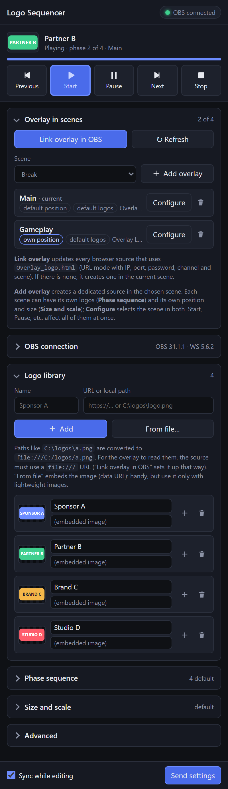
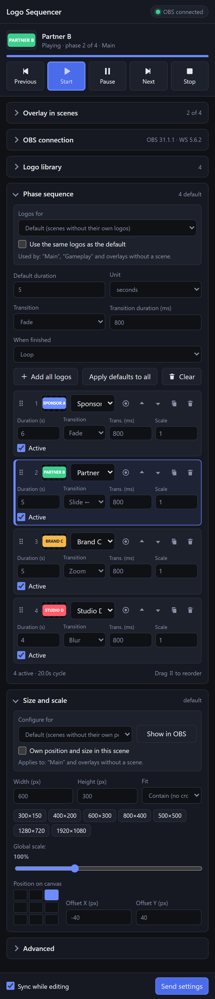
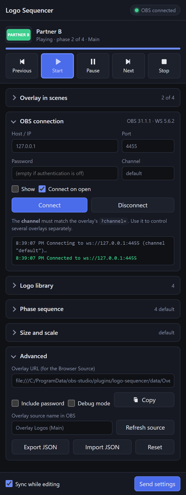

# Logo Sequencer — User guide

**English** · [Español](GUIA.md) · [← Back to README](../README.md)

This guide explains every part of the Logo Sequencer dock, from the first setup to per-scene configuration.

## Contents

1. [Before you start](#1-before-you-start)
2. [The dock at a glance](#2-the-dock-at-a-glance)
3. [Step 1 — Add the overlay to your scenes](#3-step-1--add-the-overlay-to-your-scenes)
4. [Step 2 — Build your logo library](#4-step-2--build-your-logo-library)
5. [Step 3 — Create the sequence](#5-step-3--create-the-sequence)
6. [Step 4 — Size and position](#6-step-4--size-and-position)
7. [Different logos and position per scene](#7-different-logos-and-position-per-scene)
8. [Playing the sequence](#8-playing-the-sequence)
9. [Connection, advanced options and backups](#9-connection-advanced-options-and-backups)
10. [Tips and FAQ](#10-tips-and-faq)

---

## 1. Before you start

1. **Install the plugin** with the installer from the [latest release](https://github.com/KaguroDev/logo-sequencer-plugin/releases/latest) (close OBS first).
2. **Enable the OBS WebSocket server**: *Tools → WebSocket Server Settings → Enable WebSocket server*. Then restart OBS.
   The dock and the overlay talk to each other through this server. You don't need to copy the port or password: the plugin reads them by itself.
3. **Open the dock**: *Docks* menu → check **Logo Sequencer**. You can drag it next to your other docks.

> The dock and the overlay need an internet connection to load the `obs-websocket-js` library.

## 2. The dock at a glance

From top to bottom:

| Part | What it does |
|---|---|
| **Connection pill** (top right) | *OBS connected* (green), *Connecting…*, *Reconnecting…*, *Error* or *Disconnected*. |
| **Now playing** | Thumbnail, logo name, state (*Playing*, *Paused*, *Stopped*, *Finished*), phase number and scene. |
| **Progress bar** | Time left for the current logo. |
| **Transport** | ⏮ Previous · ▶ Start · ⏸ Pause · ⏭ Next · ⏹ Stop. |
| **Sections** | *Overlay in scenes*, *OBS connection*, *Logo library*, *Phase sequence*, *Size and scale*, *Advanced*. Click a title to expand or collapse it. |
| **Footer** | *Sync while editing* and *Send settings*. |

The state shown at the top is the one of the overlay that is **live on program**. If none is live, it shows the last overlay that responded.

 

## 3. Step 1 — Add the overlay to your scenes

The **overlay** is a Browser Source that shows the logos on your stream. Each scene where you want logos needs one.

In the **Overlay in scenes** section:

1. Choose a scene in **Scene** and press **Add overlay**.
   A source called `Overlay Logos (<scene>)` is created in that scene, with the size of your canvas.
2. Repeat for every scene where you want the logos.

The list below shows every scene that has the overlay:

| Element | Meaning |
|---|---|
| *· current* | The scene that is currently on program (or in the preview, in Studio Mode). |
| *default position* / *own position* | Whether the scene uses the default size and position or its own ([section 7](#7-different-logos-and-position-per-scene)). |
| *default logos* / *own logos* | Whether the scene shows the default sequence or its own. |
| **Configure** | Selects that scene for editing in *Phase sequence* and *Size and scale*. |
| 🗑 | Removes the overlay from that scene. |

**Other buttons:**

- **Link overlay in OBS** — updates every overlay source (connection, channel and scene in its URL). If there is none, it creates one in the current scene. Use it if an overlay stops responding, or after renaming a scene: the source keeps its logos and position under the new name.
- **↻ Refresh** — reads the scene list from OBS again (for example, after creating a scene).

> **Alternative:** *Tools → Logo Sequencer: create / update overlay* does the same as *Link overlay*: it updates all overlay sources and, if the current scene has none, creates one there.
> When OBS starts, the plugin also updates all overlay sources automatically, so a change of WebSocket port or password is picked up after a restart.

## 4. Step 2 — Build your logo library

The **Logo library** holds every logo you can use. Add logos in any of these ways:

| Method | How |
|---|---|
| **URL** | Type a name (optional) and an `https://…` address, then press **Add** (or Enter). |
| **Local path** | Type or paste a path such as `C:\logos\sponsor.png`. It is converted to `file:///C:/logos/sponsor.png`. |
| **From file…** | Choose one or more images. They are embedded in the configuration. |
| **Drag and drop** | Drag images from the Windows Explorer onto the list. They are embedded too. |

If you leave the name empty, the file name is used.

**Each logo in the list** shows its thumbnail, an editable name and its path or URL. A red **!** on the thumbnail means the image could not be loaded.

- **+** adds the logo to the sequence you are editing.
- 🗑 deletes the logo. If it is used in any sequence, the dock asks first and removes it from **all** sequences.

> **Tip:** prefer **local paths** for large images. Embedded images (*From file*, drag and drop) are convenient but make the configuration heavier; the dock warns you about images over 1.5 MB.
> PNG with a transparent background looks best on stream.

## 5. Step 3 — Create the sequence

A **sequence** is the ordered list of logos (*phases*) that the overlay plays.

**Default values** (used for new phases):

| Field | Description |
|---|---|
| **Default duration** + **Unit** | How long each logo stays on screen, in *seconds* or *milliseconds* (minimum 0.25 s). |
| **Transition** | How a logo enters (see the table below). |
| **Transition duration (ms)** | Length of the transition. |
| **When finished** | *Loop* (start again), *Hold last logo* (keep it on screen) or *Hide* (fade out and stop). |

**Buttons:**

- **Add all logos** — adds every logo of the library to the sequence.
- **Apply defaults to all** — applies the default duration and transition to every phase.
- **Clear** — deletes all phases of this sequence (asks first).

**Each phase** has:

| Control | Description |
|---|---|
| ⠿ | Drag to reorder (or use ▲ ▼). |
| Number and thumbnail | Position in the sequence and the logo. |
| Logo selector | Change which logo this phase shows. |
| ◎ **Show now** | Jumps straight to this phase on the overlay. |
| ▲ ▼ | Move up / down. |
| ⧉ **Duplicate** | Copies the phase right below it. |
| 🗑 | Deletes the phase. |
| **Duration** | Time on screen for this phase only. |
| **Transition** / **Trans. (ms)** | Entry transition and its duration for this phase. |
| **Scale** | Size of this logo relative to the others (1 = normal, 0.5 = half, 2 = double). |
| **Active** | Uncheck to skip the phase without deleting it. |

The highlighted phase is the one currently on screen. The line below the list shows how many phases are active and the length of a full cycle.

**Transitions:**

| Transition | Effect |
|---|---|
| Fade | The new logo fades in while the previous one fades out. |
| Slide ← / Slide → / Slide ↑ | The new logo slides in and pushes the previous one out. |
| Zoom | The new logo grows in; the previous one grows and fades out. |
| Blur | The new logo comes into focus. |
| Cut | Instant change, no animation. |

 

## 6. Step 4 — Size and position

In **Size and scale** you define the area where the logos are drawn, inside the overlay (which has the size of your canvas, for example 1920×1080).

| Field | Description |
|---|---|
| **Width / Height (px)** | Size of the logo area, in canvas pixels. The buttons below are quick presets (300×150 to 1920×1080). |
| **Fit** | *Contain* (the whole logo is visible, no cropping), *Cover* (fills the area, may crop) or *Stretch* (fills the area, may deform). |
| **Global scale** | Enlarges or reduces every logo (10 % to 300 %). It is multiplied by the *Scale* of each phase. |
| **Position on canvas** | Nine-point grid: corners, edges or center of the screen. |
| **Offset X / Y (px)** | Fine adjustment from that position. Use negative values to move left or up (for example, X −40 and Y 40 in the top-right corner leaves a 40 px margin). |

Changes are visible on the overlay right away (see [Sync while editing](#sync-while-editing)).

## 7. Different logos and position per scene

Each scene with an overlay can have **its own logos** and **its own size and position**. Scenes without their own settings use the **default** ones.

**Logos per scene** — in *Phase sequence*, **Logos for** chooses what you are editing:

- **Default** — the sequence used by every scene without its own logos.
- **A scene** — while *Use the same logos as the default* is checked, the scene shows the default sequence (read-only here). **Uncheck it** and the scene gets its own sequence, starting as a copy of the default one. Check it again to discard it.

**Position per scene** — in *Size and scale*, **Configure for** works the same way:

- **Default** — used by every scene without its own position.
- **A scene** — as soon as you change any value, the scene gets its **own position**. Uncheck *Own position and size in this scene* to go back to the default.
- **Show in OBS** switches to that scene so you can see the result. In Studio Mode it changes the preview; otherwise it asks first, because it changes the live scene.

> **Shortcut:** the **Configure** button of each scene in *Overlay in scenes* selects that scene in both sections at once.

**Example:** the default sequence shows four sponsors in the top-right corner. The *Gameplay* scene has its own logos (only the main sponsor), smaller and in the bottom-left corner so they don't cover the game HUD.

## 8. Playing the sequence

| Action | Dock button | Key in the dock | OBS hotkey |
|---|---|---|---|
| Start / Pause | ▶ / ⏸ | `Space` | *Logo Sequencer: Start / Pause* |
| Start | ▶ | | *Logo Sequencer: Start sequence* |
| Pause | ⏸ | | *Logo Sequencer: Pause* |
| Next logo | ⏭ | `→` | *Logo Sequencer: Next logo* |
| Previous logo | ⏮ | `←` | *Logo Sequencer: Previous logo* |
| Stop | ⏹ | `Esc` | *Logo Sequencer: Stop* |

- The controls act on **every scene at the same time**.
- **Pause** keeps the logo on screen and remembers the time left; **Start** continues from there.
- **Stop** hides the logo with its transition and goes back to the beginning.
- Dock keys work when the dock has focus and you are not typing in a field.
- **OBS hotkeys** are assigned in *Settings → Hotkeys* (search for "Logo Sequencer"). They work even when the dock is hidden — ideal for a Stream Deck.
- If an image cannot be loaded, the overlay skips to the next logo and the dock shows a notification.

### Sync while editing

With **Sync while editing** checked (the default), every change in the dock is sent to the overlay automatically. Uncheck it to prepare changes without affecting the stream, then press **Send settings** to apply them all at once.

## 9. Connection, advanced options and backups

### OBS connection

Filled in automatically by the plugin. You only need it to control **another OBS** on your network, or to troubleshoot.

| Field | Description |
|---|---|
| **Host / IP** | `127.0.0.1` for the same PC. For another PC, its local IP (and allow the port in its firewall). |
| **Port** / **Password** | From *Tools → WebSocket Server Settings → Show Connect Info*. |
| **Channel** | Lets several independent overlay groups coexist: each dock only controls overlays with the same `?channel=`. Leave `default` if you don't need it. |
| **Connect on open** | Connect automatically when the dock opens. |

The log below the buttons shows connection events and errors.

### Advanced

| Option | Description |
|---|---|
| **Overlay URL** | Address to set up an overlay by hand (Browser Source → URL, without *Local file*). **Copy** copies it. |
| **Include password** | Adds the WebSocket password to that URL. Sources created with *Add overlay* or *Link overlay* always include it. |
| **Debug mode** | Overlays created or linked afterwards show a status box and the outline of the logo area. Turn it off and press *Link overlay in OBS* to remove it. |
| **Overlay source name** + **Refresh source** | Reloads that Browser Source (like its *Refresh cache of current page* button). The name is filled in when you add or link an overlay. |
| **Export JSON** | Saves logos, sequences and settings to a `.json` file. The password is never exported. |
| **Import JSON** | Loads a configuration exported before. Your current password is kept. |
| **Reset** | Deletes logos, phases and settings (asks first). The connection is kept. |

 

### Where your settings are saved

Everything is saved automatically inside OBS and is kept after restarting OBS or updating the plugin. Use **Export JSON** as a backup, or to copy your setup to another PC.

## 10. Tips and FAQ

**Can I use different logos in each scene?** Yes, see [section 7](#7-different-logos-and-position-per-scene).

**Can I control it from a Stream Deck?** Yes: assign the OBS hotkeys (*Settings → Hotkeys*) and trigger them from the Stream Deck.

**How do I change the language?** Run the installer again and choose the other language. Your logos and settings are kept.

**The overlay does not respond.** Check the connection pill and press **Link overlay in OBS**. If you changed the WebSocket password, restart OBS.

**A logo is not shown.** Check that the path or URL still exists. Local paths must point to an image on the PC where OBS runs.

**I renamed a scene and the overlay lost its settings.** Press **Link overlay in OBS**: it links the source to the new name and keeps its logos and position.

More solutions in the [README troubleshooting section](../README.md#troubleshooting).
